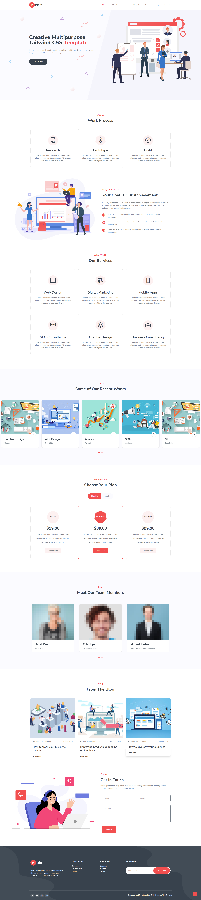

# Agency Plain - Creative Multipurpose Tailwi
 

**Plain** est un template web moderne, élégant et entièrement responsive, conçu avec **Tailwind CSS**. Il est idéal pour les agences, freelances, startups ou tout projet SaaS ou business souhaitant une présentation professionnelle.

---

## 🖼️ Aperçu Visuel




---

## 🚀 Fonctionnalités Clés

- 🎯 Landing page professionnelle et épurée
- 📱 Design 100% responsive
- ⚡️ Basé sur **Tailwind CSS** pour une personnalisation rapide
- 🧱 Sections réutilisables : services, équipe, blog, projets, tarifs, contact
- 🌙 Design clair, minimaliste et esthétique

---

## 🧑‍💻 Développeur

Développé avec soin par :

**Ismail MOUAYAHDA**  
📧 ismail.mouayahda@gmail.com

---

## 🛠️ Stack Technique

- **Framework CSS** : [Tailwind CSS](https://tailwindcss.com)
- **Icons** : Lucide Icons ou SVG personnalisés
- **Outils recommandés** : React / Vite / Next.js (optionnel pour intégration dynamique)

---

## 📦 Installation

Tu peux utiliser ce template en mode statique, ou bien l'intégrer à un framework comme Next.js.

### Option A - Utilisation HTML/Tailwind

```bash
# Télécharger les fichiers
git clone https://github.com/ton-compte/plain-tailwind-template.git
cd plain-tailwind-template

# Ouvrir dans un navigateur
open index.html
```

### Option B - Avec React & Tailwind

```bash
npx create-react-app plain-template --template cra-template-tailwindcss
cd plain-template

# Ajouter tes composants manuellement ou copier/coller les sections HTML
```

---

## 📌 Sections Incluses

- Hero section
- Work Process
- Services
- Portfolio / Projects
- Pricing Plans
- Team Members
- Blog
- Contact form
- Footer complet avec newsletter

---

## 🧩 Utilisation

Le template est conçu pour être facilement découpé en composants (React, Vue ou HTML partiels). Il s’adapte aux besoins de portfolios, agences, landing pages, etc.

---

## 📄 Licence

Ce template est open-source, usage personnel ou commercial permis.

MIT License – voir [LICENSE](./LICENSE).

---

## ❤️ Crédits

Illustrations par [Undraw](https://undraw.co/) et [DrawKit](https://www.drawkit.com/)

---

### ✨ _Designed & Developed by Ismail MOUAYAHDA_
```
 